# BurpShot

**BurpShot** is a Burp Suite extension (Montoya API) that builds clean, consistent evidence screenshots for penetration-test
reports - and lets you finish them without leaving Burp: crop, annotate, redact, add tables, terminals, rendered pages and more.

* The image is **drawn directly** (Java2D) from the captured message - no OCR, no screen scraping - so it is crisp at any
  scale and always has the same look: red Calibri labels, Burp-style syntax colours, grey separators.
* Everything is a **layer** (request, response, text, table, terminal, image, drawing). Layers can be moved, resized, aligned,
  cropped and annotated, and everything is saved in your Burp project.
* Output: live preview, **Copy image**, **Save PNG**, or a separate **Preview window** you can capture with another tool.
* Works in **Burp Suite Community Edition and Professional**: it uses only the Montoya API features that both editions provide (no Pro-only scanner / Collaborator features). In Community Edition, projects are temporary, so use the folder storage option of *Storage...* if you want captures to survive a restart.

---

## Contents

1. [Install and build](#1-install-and-build)
2. [Quick start](#2-quick-start)
3. [The BurpShot tab](#3-the-burpshot-tab)
4. [Content tab](#4-content-tab)
5. [Annotations: boxes, arrows, pixelate, blur](#5-annotations-boxes-arrows-pixelate-blur) (incl. the preview's right-click menu)
6. [Annotations tab and Style & layout tab](#6-annotations-tab-and-style--layout-tab)
7. [Tool palette](#7-tool-palette)
8. [Working with layers](#8-working-with-layers)
9. [Adding content](#9-adding-content)
10. [Terminal layer](#10-terminal-layer)
11. [Output, width and scale](#11-output-width-and-scale)
12. [Undo / redo, saving and encryption](#12-undo--redo-saving-and-encryption)
13. [Share (save to remote)](#13-share-save-to-remote)
14. [Global settings](#14-global-settings)
15. [Keyboard and mouse reference](#15-keyboard-and-mouse-reference)
16. [Notes and limits](#16-notes-and-limits)

---

## 1. Install and build

**Install:** Burp -> *Extensions* -> *Add* -> Extension type **Java** -> select `burpshot.jar` (a prebuilt copy is in the repository root).

**Build from source** (JDK 17 or newer):
* `./build.sh` (Git Bash on Windows, Linux, macOS) - verifies the bundled SSH library's checksum, compiles, and writes `burpshot.jar`. It expects the Montoya API jar at `../montoya-api.jar` (or set `MONTOYA=/path/to/montoya-api.jar`).
* or the Gradle wrapper: `./gradlew build` (`gradlew.bat build` on Windows; any JDK 17 or newer, the bytecode targets Java 17). The extension jar is written to `build/libs/burpshot.jar`. The files under `src/test` are plain programs, run by hand as shown below, not part of the Gradle build.

The extension jar bundles one third-party library, **JSch** (`com.github.mwiede:jsch` 2.28.8, BSD licence), for SFTP/SCP in [Share](#13-share-save-to-remote). It is kept in `libs/` with its SHA-256 and licence notice and is checked on every build. Everything else uses only the JDK.

**Self-tests** (no Burp needed; use `:` instead of `;` in the class path on Linux / macOS):
```
javac -encoding UTF-8 --release 17 -cp "../montoya-api.jar;libs/jsch-2.28.8.jar" -d out src/main/java/ptshot/*.java src/test/java/ptshot/*SelfTest.java
java -cp "out;libs/jsch-2.28.8.jar" ptshot.CoreSelfTest      # encryption, tamper / zip-bomb / hostile-JSON checks, storage modes
java -cp "out;libs/jsch-2.28.8.jar" ptshot.MigrateSelfTest   # import of captures saved by older versions
java -cp "out;libs/jsch-2.28.8.jar" ptshot.RemoteSelfTest    # upload backends and the request view against local mock servers
java -cp "out;libs/jsch-2.28.8.jar" ptshot.ShareSelfTest     # validation of the saved Share profiles / host keys
java -cp "out;libs/jsch-2.28.8.jar" ptshot.SavePngSelfTest   # Save PNG: plain / encrypted, locked and off states
java -cp "out;libs/jsch-2.28.8.jar" ptshot.BeautifySelfTest   # JS / CSS / inline script pretty-printing
java -cp "out;libs/jsch-2.28.8.jar" ptshot.HighlightSelfTest   # syntax colours, incl. Cookie / Set-Cookie
java -cp "out;libs/jsch-2.28.8.jar" ptshot.BorderSelfTest   # layer / capture borders: saving, drawing, clamping
java -cp "out;libs/jsch-2.28.8.jar" ptshot.RecoverySelfTest   # mixed / foreign locked captures, 'Forgot the password'
java -cp "out;libs/jsch-2.28.8.jar" ptshot.Fuzz 40   # random action sequences must never lose or lock out data
java -cp "out;libs/jsch-2.28.8.jar" ptshot.StorageDialogSelfTest   # drives the real Storage dialog (needs a display)
java -cp "out;libs/jsch-2.28.8.jar" ptshot.CutOutSelfTest    # "cut out and join" pixel checks
java -cp "out;libs/jsch-2.28.8.jar" ptshot.PanelSelfTest     # real panels: save / restart / unload timing (needs a display)
```
`RemoteSftpServerTest` (SFTP against an in-process SSH server) needs extra jars; the list is in its header comment.

After loading, a **BurpShot** tab appears in Burp's top tab bar and a *Send to BurpShot* item in the right-click menu.

---

## 2. Quick start

1. In Proxy, Repeater, Logger, Target... right-click one or more requests -> **Extensions -> BurpShot -> Send to BurpShot**.
   Each request (with its response) opens as its own capture tab.

   **Shortcut:** select the request(s) in a table (Proxy history, Intruder results, Organizer, site map) or click into a message editor and press **Ctrl+Alt+B**. (Ctrl+B is Burp's own *Base64-encode selection*, so it is not used.) The shortcut can be changed or removed in Burp under *Settings -> User interface -> Hotkeys*; look for *BurpShot: Send to BurpShot*.

   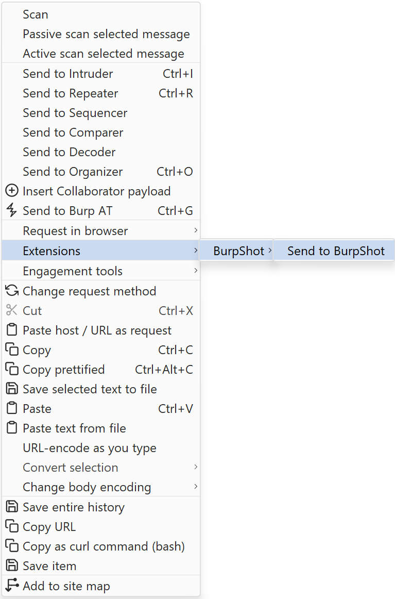

2. Open the **BurpShot** tab. The right side is the live preview, the left side is where you choose *what* is shown.
3. In the **Content** tab, hide headers you do not need, switch **Pretty / Raw**, and edit the text if necessary.
4. Select text -> **right-click** -> *Box*, *Arrow*, *Pixelate* or *Blur* to highlight or redact it.
5. Use **Copy image** (clipboard) or **Save PNG...** in the preview toolbar.

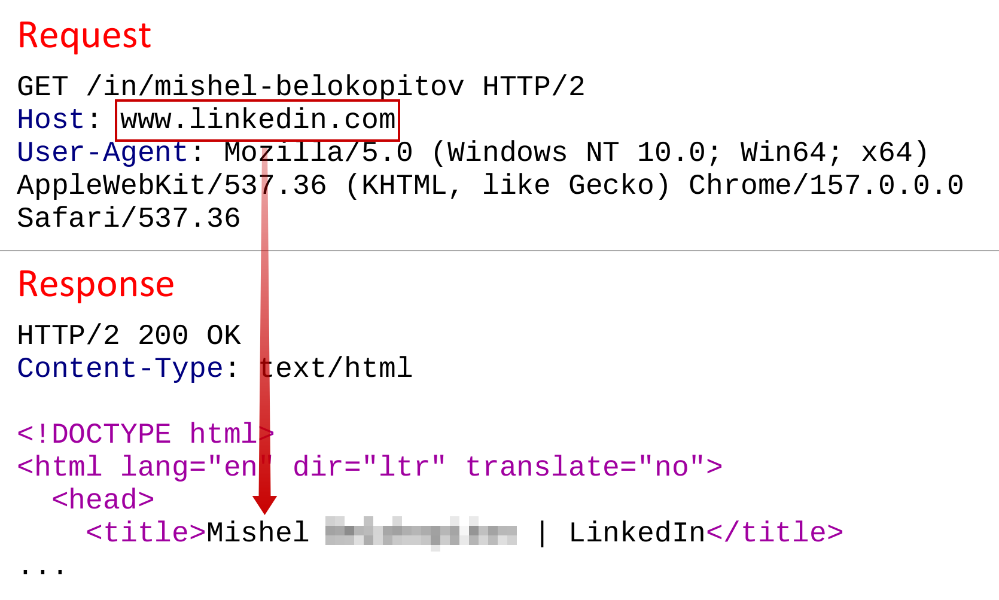

---

## 3. The BurpShot tab

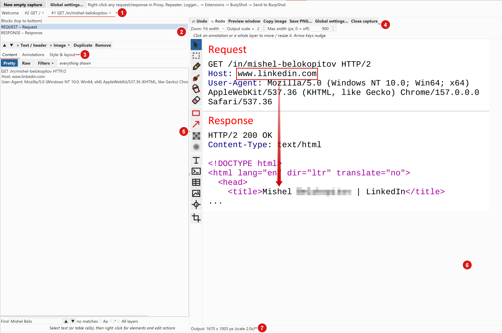

**1** capture tabs - **2** Blocks list - **3** Content / Annotations / Style & layout tabs - **4** preview toolbar - **5** tool palette - **6** preview - **7** status line

| Area | What it is |
|---|---|
| Top bar | **New empty capture** (a blank request/response to start from) and **Global settings...** |
| Capture tabs | One tab per capture. See [3.1](#31-capture-tabs). |
| Left: **Blocks** list | Every layer of the capture, top to bottom. See [3.2](#32-the-blocks-list). |
| Left: three tabs | **Content**, **Annotations**, **Style & layout** - settings for the layer selected in the Blocks list. |
| Right: preview toolbar | Undo / redo, export, zoom, output scale, max width. See [3.3](#33-preview-toolbar). |
| Right: tool palette | Vertical tool bar left of the preview. See [section 7](#7-tool-palette). |
| Right: preview | The live image. Click, drag, resize, **right-click** (menu) and press **Del** directly on it. |
| Bottom line | Status messages and the output size (`Output: 1019 x 635 px (scale 2.0x)`), with warnings for very tall or wide images. |

The divider between the left panel and the preview can be dragged (or collapsed with its small arrows).

### 3.1 Capture tabs

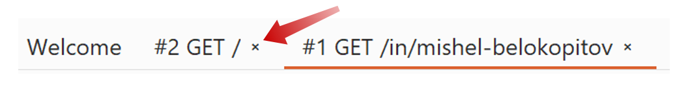

| Action | How |
|---|---|
| Close a capture | Click the **x** on its tab, middle-click the tab, or **Close capture** in the preview toolbar. The capture is removed from the project. |
| Rename | Double-click the tab title. |
| New blank capture | **New empty capture** in the top bar. |

### 3.2 The Blocks list

Each row is a layer: `REQUEST`, `RESPONSE`, `CUSTOM` (text), `TABLE`, `TERMINAL`, `IMAGE`. The freehand layer shows as `IMAGE - Drawing`.
A block that is placed beside the previous one is shown indented with an arrow.

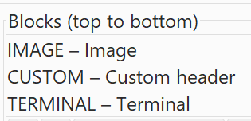

| Button | Does |
|---|---|
| **Up / Down arrows** | Move the selected block up or down (order = top-to-bottom order in the image). |
| **+ Text / header** | Add a custom text block (headers, footers, notes - for example `11,898 bytes | 1,542 millis`). |
| **+ Image** | Add an image from a **file** or from the **clipboard**. |
| **Duplicate** | Copy the selected block (including its annotations). |
| **Remove** | Delete the selected block. |

Selecting a block shows its settings in the three tabs. Clicking a layer in the preview selects it here too.

### 3.3 Preview toolbar

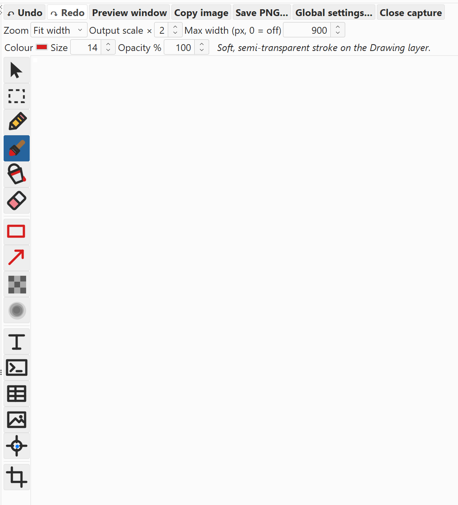

| Control | Does |
|---|---|
| **Undo / Redo** | Step through the history of this capture ([section 12](#12-undo--redo-saving-and-encryption)). |
| **Preview window** | Opens the image in its own window (zoomable, with Copy / Save) so you can capture it with an external tool. |
| **Copy image** | Copies the PNG to the clipboard. |
| **Save PNG...** | Saves the PNG to a file. With encryption turned on, the save dialog has an **Encrypt with my BurpShot password** box (see [12.3](#123-encryption-at-rest)). |
| **Global settings...** | Opens [global settings](#14-global-settings). |
| **Close capture** | Closes this capture. |
| **Zoom** | Fit width, 25 %, 50 %, 75 %, 100 %, 150 % (display only, does not change the output). |
| **Output scale x** | Pixel density of the exported image (1x - 4x; default 2x). |
| **Max width (px, 0 = off)** | Hard limit on the image width, see [section 11](#11-output-width-and-scale). |
| Tool-options row | Colour, size, opacity, tolerance and a one-line hint for the active tool (see [7.2](#72-paint-tools)). |

---

## 4. Content tab

Shows the content of the selected layer. What you see depends on the layer type.

### 4.1 Request / Response layers

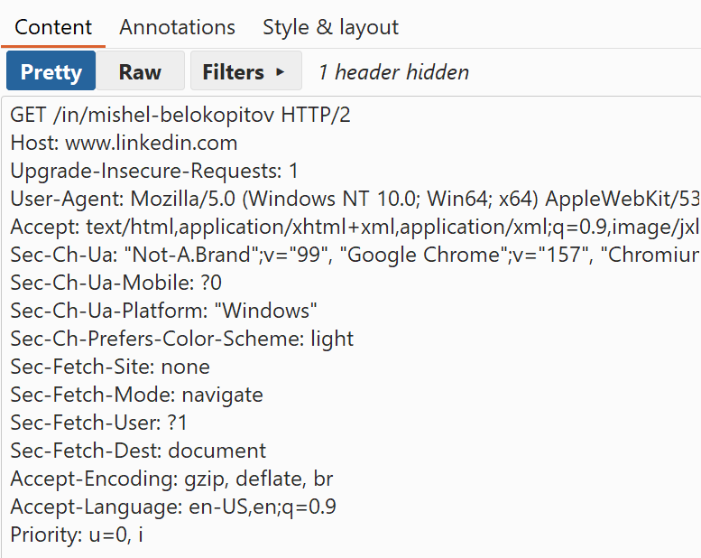

**Pretty / Raw.** Switch between the two views of the body:
* **Pretty** (default) re-indents JSON, XML, HTML (including inline `<script>` and `<style>` blocks), **JavaScript and CSS** (minified bundles become one statement per line, so you can pick a single line and keep only it). Strings, template literals, regular expressions and comments are never touched, and the code is never executed. Switching a JavaScript/CSS body back to *Raw* keeps the formatted text you see; use *Reset text* to get the original bytes. **Very long lines** (for example the `mappings` value of a `.js.map` source map, which can be megabytes on one line) are cut after 2,000 characters with a marker such as `...[7800000 more characters not shown]`, in both Pretty and Raw view; this keeps the editor responsive and the evidence readable. The format is taken from the `Content-Type` header, or guessed from the body.
* **Raw** shows the body exactly as captured.

Switching **Pretty / Raw keeps your manual edits**: only the body of the text as it is now is re-formatted (Pretty re-indents it, Raw compacts it again), so deleted headers, removed lines and `...` parts stay as you left them. Changing a **filter** or pressing *Reset text*, on the other hand, rebuilds the text from the captured message - **manual edits to that layer are lost**.

**Filters.** Click **Filters >** to open them (they are collapsed by default; the line next to the button summarises what is hidden, e.g.
`1 header hidden, body cut at 500`).

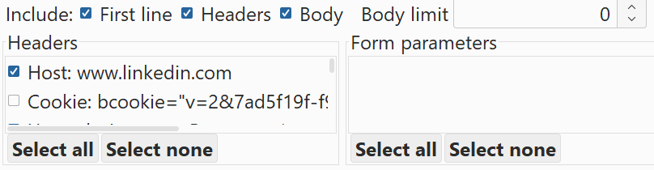

| Filter | Does |
|---|---|
| **Include: First line / Headers / Body** | Show or hide each part. |
| **Body limit** | Cut the body after this many characters (0 = all). |
| **Headers** list | Untick a header to hide it. **Select all / Select none** act on the whole list. |
| **Form parameters** list | Same for `a=1&b=2` bodies (hide single parameters). |
| **Reset text** | Throw away manual edits and rebuild from the captured message. |

### 4.2 Editing the text

The box is a normal text editor: type, delete, paste. Select text and **right-click** for the actions below.

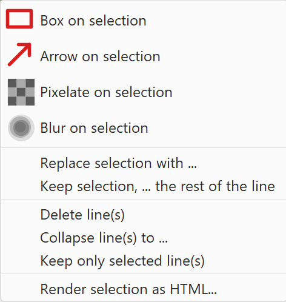

| Menu item | Does |
|---|---|
| **Box on selection**, **Arrow on selection**, **Pixelate on selection**, **Blur on selection** | Attach that element to the selected text ([section 5](#5-annotations-boxes-arrows-pixelate-blur)). |
| **Replace selection with ...** | Replace the selected text with `...` (hide part of a value). |
| **Keep selection, ... the rest of the line** | Keep the header name and the selected part, replace the rest of the line with `...` (e.g. `Cookie: ...session=abc...`). |
| **Delete line(s)** | Remove the selected line(s). |
| **Collapse line(s) to ...** | Replace the selected line(s) with a single `...` line (e.g. skipped JSON elements). |
| **Keep only selected line(s)** | Keep the selected line(s) and collapse everything else into `...`. |
| **Render selection as HTML...** | See [9.4](#94-rendered-html). |

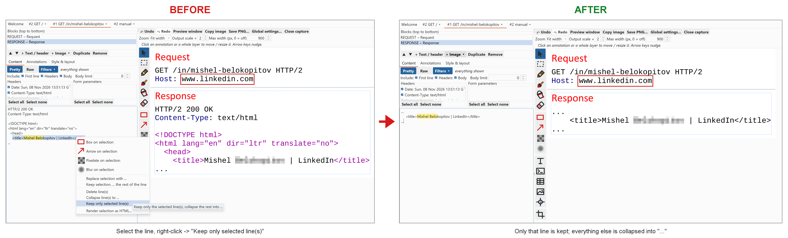

*Example:* with the `<title>` line selected, **Keep only selected line(s)** keeps that line and collapses everything before and after it into `...` (before / after, as shown in the preview on the right of each half).

### 4.3 Search in the editor

A **Find** bar sits under the editor for request, response, custom text and terminal layers (not for tables and images).

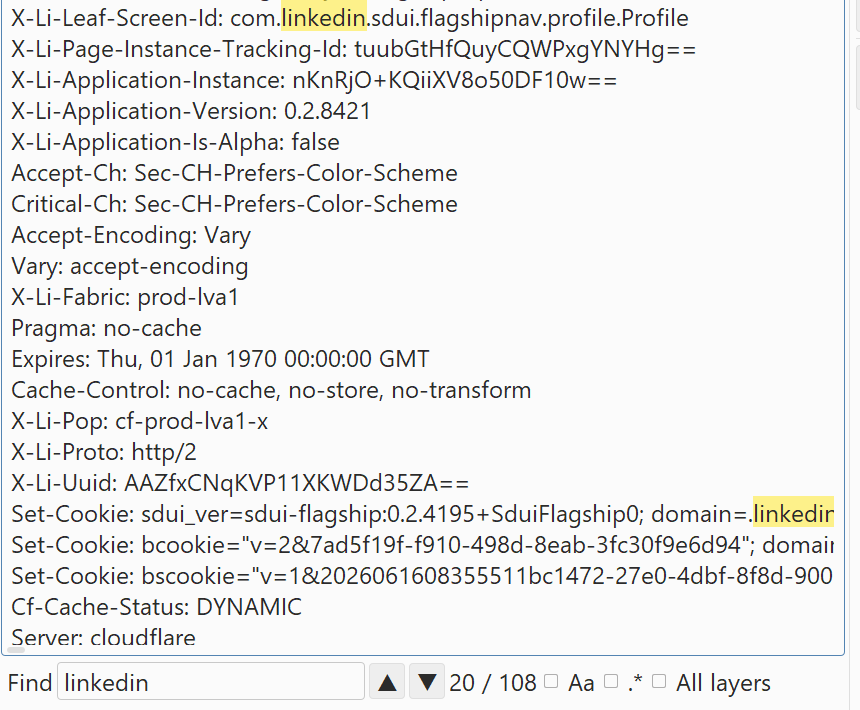

| Control | Does |
|---|---|
| **Find** box (**Ctrl/Cmd+F** focuses it) | Type to highlight every match (yellow) and jump to the first one after the cursor (orange). A one-line selection in the editor is copied into the box. |
| **Enter** / **Shift+Enter**, or the **down / up** buttons | Next / previous match; wraps around at the ends. **Esc** returns to the editor. |
| Counter | `2 / 14` = current match / total, or `no matches`. |
| **Aa** | Match case. |
| **.\*** | Regular expression (an invalid pattern turns the box red). |
| **All layers** | When this layer has no more matches, continue into the next / previous layer that has one - so you can search the **request and the response** with one box. |

The current match is a normal selection, so you can search for a value and then right-click it to add a box, arrow, pixelate or blur straight onto it.

### 4.4 Other layer types in the Content tab

| Layer | Content tab shows |
|---|---|
| Custom text | The same editor (no filters). |
| Table | The table editor, see [9.1](#91-tables). |
| Terminal | The Terminal bar plus the editor, see [section 10](#10-terminal-layer). |
| Image | `(image block - no text)`. Use the palette's crop and selection tools instead. |

---

## 5. Annotations: boxes, arrows, pixelate, blur

There are four elements. Each can be added in **two ways**.

| Element | Looks like | Typical use |
|---|---|---|
| **Box** | Red rectangle outline | Highlight a value, a row, a status code |
| **Arrow** | Red gradient arrow (or simple line + head) | Point at something |
| **Pixelate** | Mosaic over the area | Redact secrets (use a large cell size) |
| **Blur** | Blurred area | Redact secrets (use a strong radius) |

### 5.1 Attached to text (right-click)

Select the text in the Content tab -> right-click -> *Box / Arrow / Pixelate / Blur on selection*.
The element is **anchored to the text**: it follows it when you change filters, edit other lines, change the wrap width or the font.
For tables, select cells (or rows) and use the same menu ([9.1](#91-tables)).

### 5.2 Free elements (palette)

Click the **Box / Arrow / Pixelate / Blur** buttons in the [tool palette](#7-tool-palette) - or right-click the preview and use **Add here** ([5.4](#54-right-click-menu-in-the-preview)), which drops it exactly at the click. From the palette the element appears in the **middle of what you
currently see** in the preview, already selected. Drag it into place, resize it with the handles. Free elements are positioned on the
canvas, not on text, so they do not follow text when it changes.

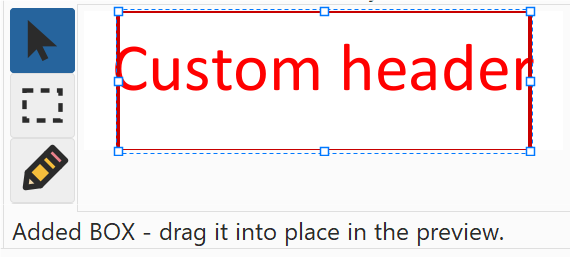

### 5.3 Editing an element in the preview

Click an element to select it (it is also selected in the **Annotations** tab).

| Action | Result |
|---|---|
| Drag the element / its border | Move it |
| Drag a handle (8 handles on boxes, pixelate, blur) | Resize it |
| Arrows: drag the **tail** or **head** circle | Move the start / change direction and length (hold **Shift** to snap to 15 degree steps) |
| Arrows: drag the line | Move the whole arrow |
| Arrow keys | Nudge 1 px (**Shift** = 10 px) |
| **Del** / Backspace | Delete the selected element (or, with a layer selected instead, the whole layer) |
| **Right-click** | [Context menu](#54-right-click-menu-in-the-preview) |
| **Esc** | Deselect |

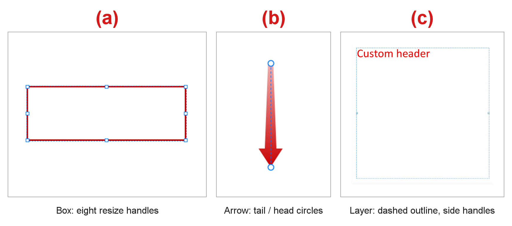

**(a)** a box: eight resize handles - **(b)** an arrow: drag the tail or head circle - **(c)** a layer (here a text layer): dashed outline with left / right width handles.

Moves and resizes are stored relative to the annotated text. *Reset position / size* (Annotations tab) snaps an element back.

### 5.4 Right-click menu in the preview

Right-click in the preview (Select tool). What is under the cursor is selected first, then the menu depends on it:

| Right-click on | Menu |
|---|---|
| An **element** (box border, arrow, pixelate / blur area) | **Delete** the element, **Reset position / size** |
| A **layer** (text, table, terminal, image, drawing) | **Delete layer**, **Duplicate layer**, **Move up / Move down** (draw order), **Crop...**, **Reset position and size**, **Align on canvas** -> Left / Centre / Right |
| Anywhere (including empty canvas) | **Add here** -> Box / Arrow / Pixelate / Blur, dropped exactly at the click |

The *Add here* items are the same elements as the right-click menu in the Content tab, but placed on the canvas at the click instead of attached to selected text. Note that a box only reacts on its border, so right-click the outline to get the element menu (inside it you get the menu of the layer behind it).

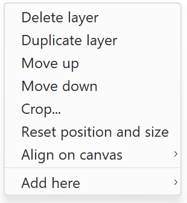

---

## 6. Annotations tab and Style & layout tab

### 6.1 Annotations tab

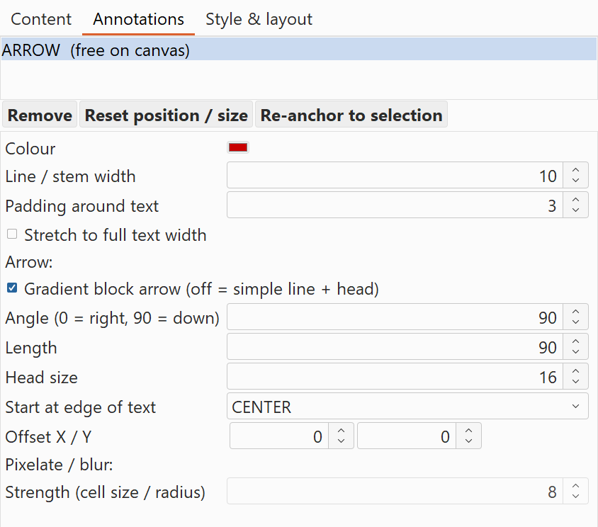

Top: the list of annotations of the selected layer (items whose text can no longer be found are greyed out as *target not found - hidden*).

| Button | Does |
|---|---|
| **Remove** | Delete the selected annotation. |
| **Reset position / size** | Undo manual moves and resizes made in the preview. |
| **Re-anchor to selection** | Attach the annotation to the text currently selected in the Content tab. |

Settings (enabled depending on the element type):

| Setting | Applies to | Does |
|---|---|---|
| Colour | box, arrow | Line / arrow colour |
| Line / stem width | box, arrow | Thickness |
| Padding around text | all | Space between the text and the shape |
| Stretch to full text width | box | Box spans the whole width of the text block |
| Gradient block arrow | arrow | On = filled gradient arrow, off = simple line + head |
| Angle, Length, Head size | arrow | Direction (0 = right, 90 = down), length, arrow-head size |
| Start at edge of text | arrow | Bottom / top / left / right / centre of the target |
| Offset X / Y | arrow | Shift the start point |
| Strength | pixelate, blur | Cell size / blur radius |

### 6.2 Style & layout tab

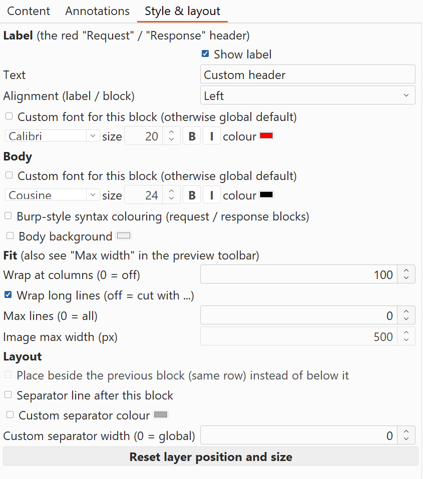

| Section | Setting | Does |
|---|---|---|
| **Label** | Show label / Text | The red heading ("Request", "Response", or anything you type) |
| | Alignment (label / block) | **Left / Centre / Right**. For a block on its own row this is a position on the **whole canvas**: choosing it snaps the layer there (and clears any horizontal move you made by dragging). |
| | Label font | Family, size, bold / italic, colour |
| **Body** | Body font | Family, size, style, colour |
| | Burp-style syntax colouring | Colours for headers, JSON keys / strings / numbers, parameters (also the names and values in `Cookie` and `Set-Cookie` headers and the fields of `multipart/form-data` bodies), tags |
| | Body background | Optional fill behind the text |
| **Fit** | Wrap at columns (0 = off) | Maximum characters per line |
| | Wrap long lines | On = wrap, off = cut with `...` |
| | Max lines (0 = all) | Truncate tall blocks with `...` |
| | Image max width (px) | Display width limit for image layers |
| **Border** | Draw a border | Turns the layer's border on or off (details in [6.3](#63-borders-layer-and-whole-capture)) |
| | Border color / width / curvature / Shadow | Colour, width (px), corner curvature (px) and drop-shadow strength (%) |
| **Layout** | Place beside the previous block | Put this block in the same row as the one above |
| | Separator line after this block | Grey rule between this block and the next |
| | Custom separator colour / width | Override the global separator |
| | **Reset layer position and size** | Undo drag-moves and resizes of this layer |

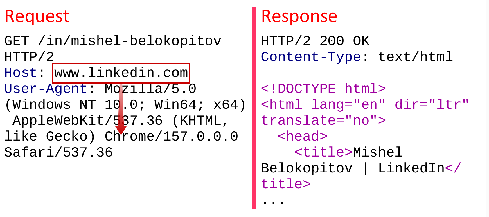

### 6.3 Borders (layer and whole capture)

Both a single layer and the whole screenshot can have a border:

| Property | Range | Does |
|---|---|---|
| **Border color** | any colour (default black) | Colour of the line |
| **Border width** | 0 - 40 px (default 2) | Thickness of the line; 0 = no line (a shadow can still be used) |
| **Border curvature** | 0 - 120 px (default 0) | Rounds the corners; the content is clipped to the rounded shape |
| **Shadow** | 0 - 100 % (default 0) | A soft drop shadow down and to the right; the higher, the bigger and darker |

The **Drop shadow preset** button sets a thin border with a soft shadow in one click.

* **One layer**: *Style & layout* tab -> **Border** section -> tick **Draw a border**. The border is drawn just *outside* the layer, so it never covers its text and never changes the layout.
* **From the tool palette**: the **Border** button (left of the preview) opens the same dialog for the selected layer or for the whole capture. The line is drawn along the edge of the image. With curvature the corners become **transparent** and with a shadow the image grows by the shadow's size, so the saved PNG has an alpha channel (Save PNG, Share and Copy image all use it; pasting into an app that ignores transparency shows the corners white or black).
* Changes are applied live; **Cancel** in the capture dialog puts the previous look back. Borders are saved with the capture (also in `.burpshot` archives and encrypted storage) and take part in Undo / Redo.
* Fine print: curved corners clip the layer's content, so text that touches the box edge can be cut at a corner - give the layer some padding or use a smaller curvature.

---

## 7. Tool palette

The vertical bar to the left of the preview. Hover any button for a tooltip.

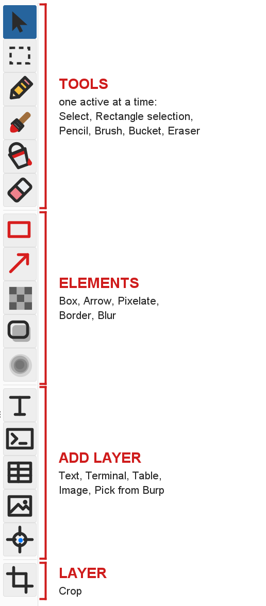

*The palette, with its four groups bracketed: Tools, Elements, Add layer, Layer.*

| Group | Buttons (top to bottom) |
|---|---|
| **Tools** (one active at a time) | Select, Rectangle selection, Pencil, Brush, Bucket fill, Eraser |
| **Elements** | Box, Arrow, Pixelate, **Border**, Blur - Border (colour, width, curvature, shadow for the selected layer or the whole capture - see [6.3](#63-borders-layer-and-whole-capture)) |
| **Add layer** | Text, Terminal, Table, Image, Pick from Burp |
| **Layer** | Crop |

### 7.1 Selection tools

| Tool | How to use | Keys |
|---|---|---|
| **Select / move** (default) | Click an annotation or a layer. Drag to move; drag handles to resize. **Right-click** for the [context menu](#54-right-click-menu-in-the-preview). | Arrow keys nudge (Shift = 10 px), **Del** deletes the selected element or layer, **Esc** deselects |
| **Rectangle selection** | Drag a rectangle anywhere on the preview. | **Del** erases the area from the selected image layer, **Enter** crops the layer to the area, **Esc** clears the selection |

The selection tools act on the layer that is selected in the **Blocks** list. For a text layer they tell you to convert it first (the **Crop** button offers that).

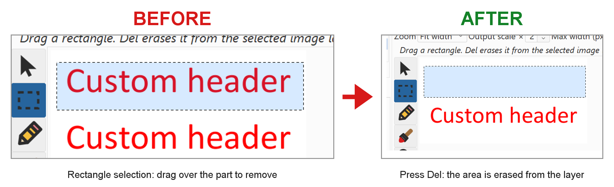

*Before: a dashed rectangle is dragged over the part to remove. After: Del has erased that area from the selected layer.*

### 7.2 Paint tools

Pencil, Brush, Bucket and Eraser all draw on **one Drawing layer** that sits on top of everything. The first stroke creates it; it appears in the
Blocks list as `IMAGE - Drawing` (remove it there to delete all drawing). Colour, size, opacity and tolerance are in the options row above the preview.

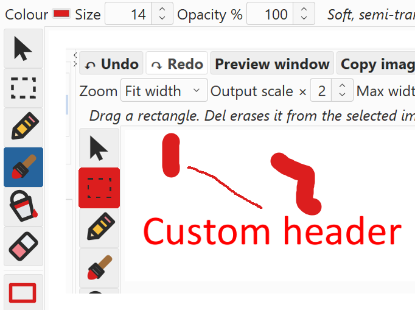

| Tool | Does | Options |
|---|---|---|
| **Pencil** | Thin, hard-edged freehand line | Colour, Size (default 2) |
| **Brush** | Soft, anti-aliased, semi-transparent stroke (a stroke does not darken where it overlaps itself) | Colour, Size (default 14), Opacity % |
| **Bucket fill** | Fills the clicked area. It looks at **everything you see** (text, tables, images), so you can fill a closed shape in the screenshot. The fill grows by one pixel so anti-aliased edges are covered. | Colour, Tolerance 0-100 (default 16; higher = fills more similar colours) |
| **Eraser** | Erases parts of the Drawing layer only | Size (default 18) |

Sizes are in 1x pixels. Each stroke or fill is one undo step. Keep tolerance low next to thin text, or the fill will eat it.

### 7.3 Element buttons

Box, Arrow, Pixelate, Blur: add a free element in the middle of the visible preview ([5.2](#52-free-elements-palette)). The same elements are in the preview's right-click menu under **Add here** ([5.4](#54-right-click-menu-in-the-preview)).

### 7.4 Add-layer buttons

| Button | Adds |
|---|---|
| **Text** | A custom text layer (header, footer, note) |
| **Terminal** | A terminal window look-alike; choose a colour scheme ([section 10](#10-terminal-layer)) |
| **Table** | An editable imitation of a Burp table ([9.1](#91-tables)) |
| **Image** | An image from a file, the clipboard, rendered HTML or a screen region ([9.3](#93-images), [9.4](#94-rendered-html), [9.5](#95-screen-region)) |
| **Pick from Burp** | Any element of Burp's own UI ([9.2](#92-pick-from-burp)) |

### 7.5 Crop

Opens the crop dialog for the selected layer ([8.3](#83-crop-and-cut-out)).

---

## 8. Working with layers

### 8.1 Select, move, resize

With the **Select** tool, click a layer in the preview: a dashed blue outline appears and the layer is selected in the Blocks list.
(Hovering shows a lighter outline.)

| Layer type | Drag | Handles |
|---|---|---|
| Text, request, response, terminal | Moves the layer | Left / right: change the **width** (the text re-wraps) |
| Table | Moves the layer | Left / right: change the width |
| Image | Moves the layer | All 8: scale proportionally (can enlarge) |
| Drawing | Moves the layer | None |

Press **Del** to delete the selected layer, or right-click it for **Delete / Duplicate / Move up / Move down / Crop / Reset / Align** ([5.4](#54-right-click-menu-in-the-preview)).

Moving a layer does not push the others around - layers can overlap on purpose. The canvas grows if a layer is dragged past the edge.
**Reset layer position and size** (Style & layout tab) returns a layer to its automatic place. Alignment: see the table in [6.2](#62-style--layout-tab).

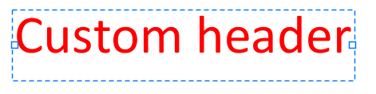

### 8.2 Order and rows

Order = order in the Blocks list. **Place beside the previous block** puts layers in one row; a row shares the available width (narrow blocks
keep theirs, wide ones split the rest). A **separator line** can be drawn after any block.

### 8.3 Crop and cut out

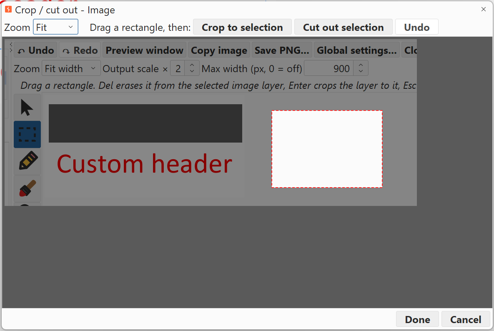

Select a layer, click **Crop** in the palette.

1. For an **image** layer the dialog opens immediately. A **text / table / terminal** layer is first converted to an image - you choose
   **Replace the layer**, **Add as a new image layer** (keeps the original), or **Cancel**. After conversion the text is no longer editable.
2. Choose the **Select** mode, then drag on the image:
   * **Rectangle** - a free rectangle.
   * **Horizontal band** - a "ray" selection: it always spans the **whole width** of the layer; you only choose which rows by dragging up / down.
   * **Vertical band** - the **whole height** of the layer; you only choose which columns by dragging left / right.
3. Then pick what to do with the selection:

   | Button | Does |
   |---|---|
   | **Crop to selection** | Keeps only the selected region (works in every mode). |
   | **Erase selection** | Makes the selected region transparent but keeps the layer's size. |
   | **Cut out and join** | Removes the selected band **completely** and joins the two remaining parts, so the layer gets shorter (horizontal band) or narrower (vertical band). Needs *Horizontal band* or *Vertical band*. |

   
   > 📷 Screenshot needed - `docs/images/37-cut-out-join.png`: a before / after pair (like `08-edit-actions.png`): on the left the crop dialog in *Horizontal band* mode with a band selected across a long response; on the right the result after *Cut out and join* (the two parts now directly above each other).

   You can cut several bands one after another (for example rows, then columns); **Undo** steps back one action. Cutting everything is refused. If the cut is at the very start of the layer, the rest of it stays where it was on the canvas; otherwise the layer keeps its top-left position and the lower / right part moves up / left.
4. **Done** applies the result to the layer, **Cancel** discards everything.

Typical use: a long response where the middle is irrelevant - select that stretch with *Horizontal band* and *Cut out and join*; the first and last parts end up directly under each other (add a `...` text layer or a separator if you want to show that something was left out).

Alternative without the dialog: use **Rectangle selection** in the preview and press **Del** (erase) or **Enter** (crop).

---

## 9. Adding content

### 9.1 Tables

**Table** button -> choose a template. All templates are fully editable.

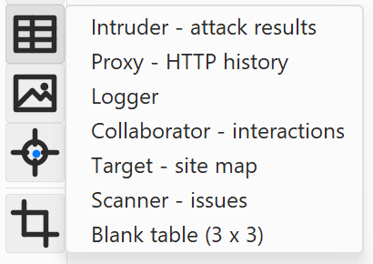

| Template | Imitates |
|---|---|
| Intruder - attack results | Intruder results table (Request, Payload, Status code, Error, Timeout, Length, Comment) with a `...` row |
| Proxy - HTTP history | Proxy history |
| Logger | Logger |
| Collaborator - interactions | Collaborator interactions |
| Target - site map | Site map |
| Scanner - issues | Scanner issues |
| Blank table (3 x 3) | Empty table to build from scratch |

**Editing:** select the table layer, open the **Content** tab.

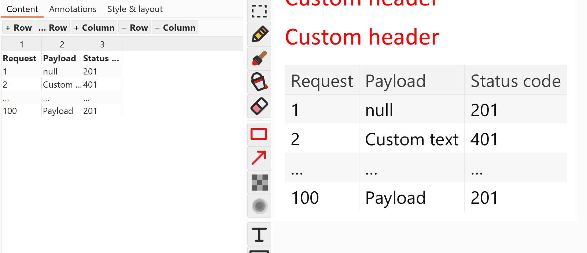

| Button | Does |
|---|---|
| Double-click a cell | Edit its text (row 1 is the header) |
| **+ Row** | Insert a row below the selected one |
| **... Row** | Insert a row of `...` below the selected one - shows that a series of requests was skipped |
| **+ Column** | Insert a column right of the selected one |
| **- Row / - Column** | Delete the selected rows / columns (at least one stays) |

**Annotating tables:** select cells (drag, or Shift-click) and right-click: *Box / Arrow / Pixelate / Blur around selected cells*, or
*Box around whole row(s)* / *Arrow to whole row(s)*. Free elements work too. Resize the table width with the layer handles.

### 9.2 Pick from Burp

Turns any piece of Burp's own UI into a layer.

1. Click **Pick from Burp** (crosshair button).
2. A blue outline follows the mouse over every Burp window and shows the element type and size. A banner at the top lists the controls:

   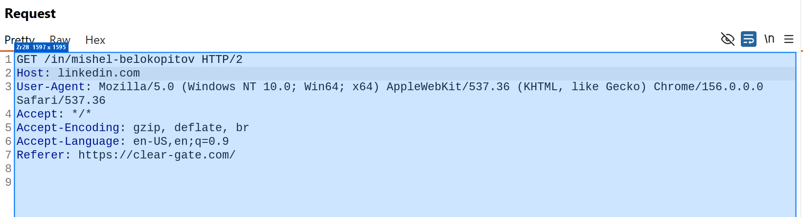

   | Input | Does |
   |---|---|
   | **Click** | Pick the outlined element |
   | **Ctrl+click** (Cmd+click on macOS) | Click through to Burp normally - **switch to another tab or screen, open a menu**, then continue picking |
   | **Mouse wheel** | Wheel up = select the parent element, wheel down = back towards the child |
   | **Esc** | Cancel |

3. A dialog asks what to create:

   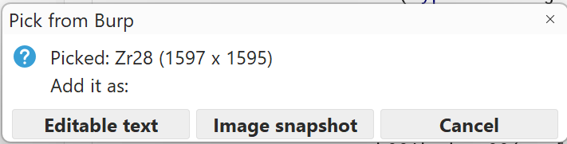

   | Choice | Offered for | Result |
   |---|---|---|
   | **Editable table** | tables and lists | A table layer with the column headers and up to 200 rows - edit it like any table |
   | **Editable text** | labels, buttons, text fields / areas | A text layer with the element's text (selected text if there is a selection) |
   | **Image snapshot** | everything | A pixel copy of how the element looks right now |

Tip: pick the scroll pane around a table to include its header in a snapshot. Windows opened *after* you start picking are not covered.

### 9.3 Images

**Image** button (or **+ Image** under the Blocks list) -> **From file...** (PNG, JPG, GIF, BMP) or **From clipboard**.
Image layers are scaled to fit the max width; resize them with the handles; crop with [8.3](#83-crop-and-cut-out).

### 9.4 Rendered HTML

**Image** -> **Render HTML...** (or right-click selected HTML -> **Render selection as HTML...**).

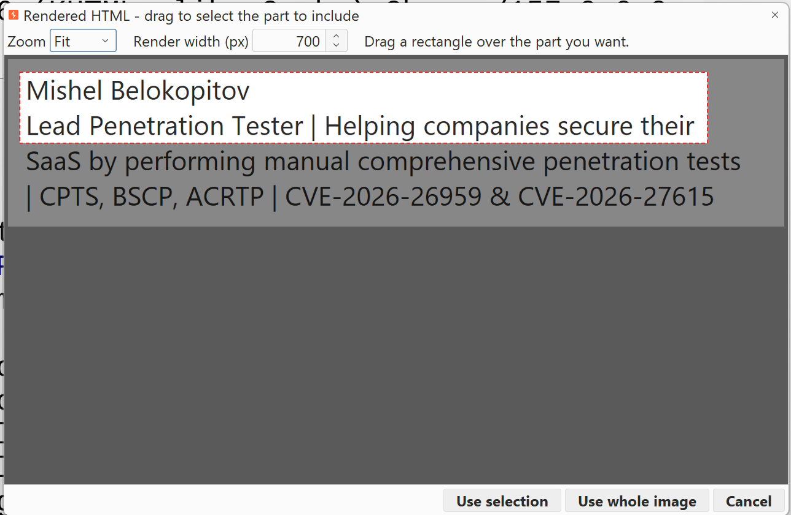

1. The HTML used is: the selected text, otherwise the whole response body, otherwise a dialog lets you **paste or type any HTML**.
2. The page is rendered (adjust **Render width**). Drag a rectangle over the part you want.
3. **Use selection** or **Use whole image** adds it as an image layer.

The renderer is Swing's HTML engine (HTML 3.2 plus a CSS subset): fine for forms, error pages, injected links and tables; not a browser.
Scripts, frames, stylesheets, CSS `url()` and images are removed (images become `[image: alt]`), form controls are drawn as `[ text ]`,
so rendering an untrusted response never touches the network.

### 9.5 Screen region

For pixel-exact output of what Burp itself shows (e.g. its *Render* tab):

1. Press **Render** on the response in Burp.
2. **Image** -> **Capture screen region...**, choose a delay (seconds), press OK.

   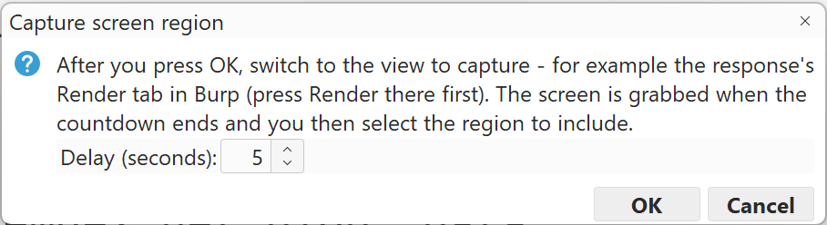

3. Switch back to Burp's Render view during the countdown. The screen is grabbed, then you drag the region to keep.

Multi-monitor and HiDPI aware. On macOS, Burp needs the Screen Recording permission.

---

## 10. Terminal layer

For PoCs that were **not** run through Burp: a terminal window look-alike with your pasted output.

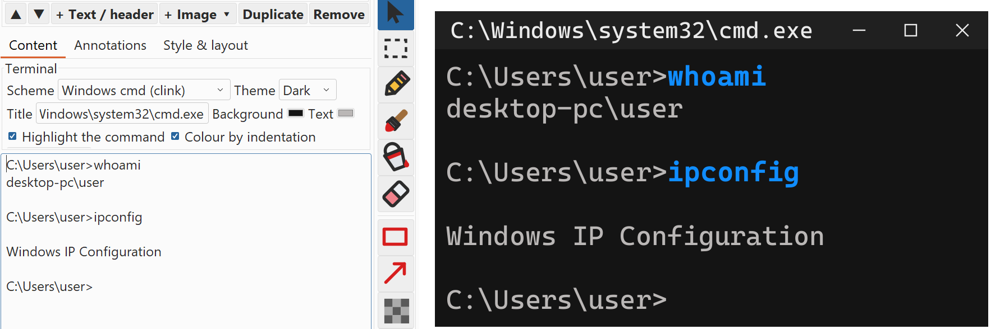

1. Click **Terminal** in the palette and choose a colour scheme.
2. In the **Content** tab, paste your command output (replace the sample text).
3. Pick **Dark** or **Light** with *Theme*, and adjust the look with the Terminal bar.
4. Annotate like any text (right-click selected text).

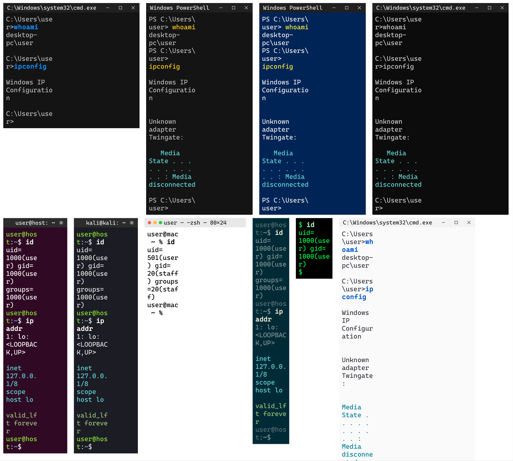

| Control | Does |
|---|---|
| **Scheme** | Windows cmd (clink), PowerShell, PowerShell (classic blue), Windows cmd (classic), Ubuntu, Kali, macOS Terminal, Solarized, Green on black. Sets colours, 16-colour palette, window frame and title. The first two imitate Windows Terminal (background `#141414`). |
| **Theme** | **Dark** or **Light** variant of the scheme (background, text, palette, command and indentation colours all switch together). Switching drops manual colour overrides. |
| **Window** | Frame around the text: None, Windows (title left, minimise / maximise / close), macOS (traffic lights, centred title), Linux (centred title, close button). |
| **Title** | Text in the title bar. |
| **Background / Text** | Override the scheme's background and default text colour. |
| **Highlight the command** | Separates the command from its output. After a prompt the command is drawn in its own colour: CMD with clink (`C:/Users/you>`) - program name in **bold bright blue**; PowerShell (`PS C:/...>`) - program name in **yellow**; Linux / macOS prompts (`user@host:~$`, `user@mac ~ %`, `$`) - the whole command in **bold**. Everything else is output. Off = no distinction. |
| **Colour by indentation** | Output lines get a different colour per indentation level (1-4 spaces, 5-8, 9 or more). Command lines are not affected. |
| **Colours...** | Edit the 16 ANSI colours (what colour code `31` = red really looks like) and the **command** and **indent level 1-3** colours. *Reset to scheme* restores them. |

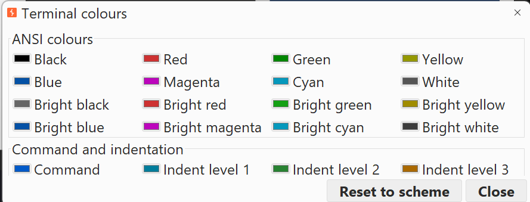

**How the command is found.** The prompt is recognised per scheme: `X:/path>` for the CMD schemes, `PS path>` for PowerShell, `user@host:path$` / `%` / `#` / a bare `$` for the Linux, macOS and other schemes. Paste the prompt together with the command, exactly as the terminal shows it. The classic cmd scheme does no command highlighting. Text that already has an explicit ANSI colour is never recoloured.

**Colours from your terminal.** ANSI colour codes in pasted text are kept: 16 colours, 256-colour, true colour, bold (brightens the 8 basic
colours), underline and reverse video. Most terminals copy plain text without colours, so to keep colours force them on in the tool
(`ls --color=always`, `nmap` output, `script`...) or copy from a source that preserves escape sequences. Escape characters appear as a small
symbol (`␛`) in the editor. Other control sequences (cursor movement, clear screen, window title) are dropped. With plain text, pick the nearest
scheme and recolour by hand. A terminal can be moved, resized (width) and cropped like any layer.

---

## 11. Output, width and scale

* **Max width (px)** in the preview toolbar (default 900 at 1x, `0` = unlimited) is a hard limit on the image width. Text wraps to fit,
  preferring natural break points (after spaces and `& , ; / ? = - ) ] }`); blocks placed beside each other share the width; images shrink.
  *Wrap at columns* (Style & layout) still applies on top - the narrower wins. *Wrap long lines* off cuts lines with `...` instead.
  A layer with a manual width ignores both.
* **Output scale** (1x - 4x) is the pixel density of the exported PNG. 2x is crisp in reports without huge files.
* The status line warns when the image is very tall (lower *Max lines* or hide headers) or wide (set a max width).
* **Copy image**, **Save PNG...** and **Preview window** all export exactly what the preview shows.

---

## 12. Undo / redo, saving and encryption

### 12.1 Undo / redo

**Undo / redo** (toolbar buttons, **Ctrl/Cmd+Z**, **Ctrl/Cmd+Y** or **Ctrl/Cmd+Shift+Z**) cover everything in a capture: text edits, filters,
annotations (add / edit / delete / move / resize), layers (add / remove / reorder / duplicate / move / resize / crop), tables, terminals,
every pencil / brush / bucket / eraser action, styles, fonts, output scale and max width. Rapid edits (typing, spinners) merge into one
step, each drag or stroke is one step. 100 steps are kept per capture; the history itself is not saved.

### 12.2 Where captures are kept

Captures are saved automatically about a second after every change. **Storage...** (top bar) chooses where:

| Option | What it means |
|---|---|
| **The Burp project file** (default) | Saved inside the project, the same way Repeater tabs persist. They come back when the project is opened again or the extension is reloaded. A *temporary* project is not saved by Burp, so captures vanish with it. |
| **This session only** | Kept in memory while Burp is open; nothing is written anywhere. Gone when Burp closes **or when the extension is unloaded / reloaded**. |
| **A folder** | One file per capture in `<chosen folder>/<project name>/` (the project name is made filesystem-safe). Handy for backups and for keeping evidence next to the report. The same place is the **default folder of Save PNG** (its `screenshots` sub-folder). |

To change it: **Storage...** -> pick an option (for a folder, type or **Browse...** to it) -> **OK**. The open captures are written to the new place and the dialog closes; the copy in the old place is left untouched. Your choice stays as you set it while you use the other buttons in the dialog, **Cancel** (or the window's X) asks before discarding a change you did not apply, and if the move fails the dialog stays open so you can correct the folder. The **encryption buttons act immediately** (they do not wait for OK). For the folder option BurpShot refuses a folder it cannot use (not creatable, or a symbolic link where the project folder should be).

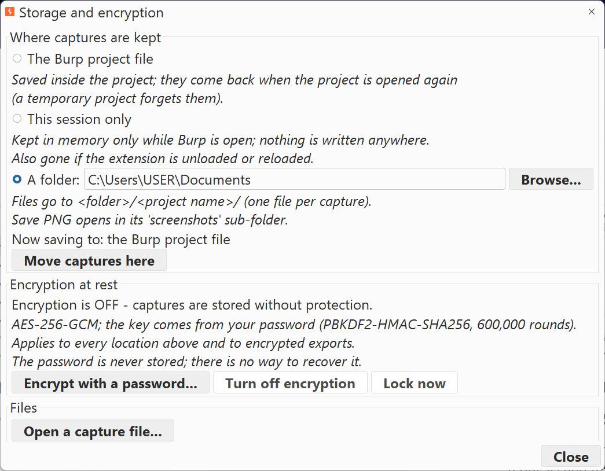

What is saved: text, filters, annotations, layer positions and sizes, tables, terminals, image layers, the drawing layer, styles and output settings. **Closing a tab deletes its saved copy.** Global settings (fonts, colours, defaults) are stored separately in Burp's user preferences.

Saving never freezes the interface: only the tabs that changed are copied on the UI thread (a few milliseconds); encoding, encrypting and writing run on a background thread, and unchanged images are not re-encoded. When Burp unloads the extension the pending writes are flushed with a hard time limit, so closing Burp cannot hang on BurpShot.

Captures saved by earlier BurpShot versions are imported automatically the first time the new version opens the project.

### 12.3 Encryption at rest

Use this when captures contain client data. **Storage... -> Encrypt with a password...** (type the password twice; at least 8 characters, a long passphrase is better). From then on every capture is stored encrypted - in the project file, in the folder, and in exports.

| Situation | What you see / do |
|---|---|
| Next time Burp opens the project | A yellow bar says the saved captures are **locked**. Click **Unlock...**, enter the password; the tabs open. |
| Before you unlock | Nothing is readable, and **nothing is ever written in the clear**: new captures wait (marked as changed) and are saved as soon as you unlock. |
| **Lock now** (Storage...) | Saves, wipes the key from memory and closes the capture tabs. The captures stay on disk, encrypted. |
| **Forgot the password...** (Storage... and the yellow bar) | The way out if the password is lost: deletes the captures that are still locked, turns encryption off, and lets you set a new password. Open tabs are kept. Without the password nothing can recover that data. |
| **Change password...** | Re-encrypts everything with the new password (you must be unlocked). |
| **Turn off encryption** | Re-writes the captures unencrypted (asks first). |


**What is encrypted - and what is not.** Turning encryption on does not touch everything automatically; this is the whole list:

| Output | Encrypted? |
|---|---|
| **Saved captures** (the tabs) - in the project file, in a folder, or in memory | **Always**, while encryption is on |
| **Save PNG...** | **Your choice, in the save dialog**: the box *Encrypt with my BurpShot password* is ticked by default when encryption is on. Ticked -> `name.png.bsv`; unticked -> a normal PNG for your report. The box is greyed out, with a reason, when encryption is off or locked. BurpShot remembers your last choice for the session. |
| **Share...** uploads | **Your choice**: the *Encrypt with my BurpShot password* box in the Share dialog (PNG -> `name.png.bsv`, archive -> encrypted `name.burpshot`) |
| **Copy image** (clipboard) and the **Preview window** | **Never** - they are meant to be pasted into your report |

A normal PNG is exactly what goes into a report, so BurpShot never forces encryption on it: encrypt the copies that are *stored or transferred*, keep the report image plain.

How it works: AES-256-GCM, with the key derived from your password by PBKDF2-HMAC-SHA256 (600,000 rounds, random salt, a fresh random IV for every file). The file header is authenticated too, so any change to a file - or a wrong password - is detected and the file is refused. A crafted file cannot make BurpShot run an expensive key derivation (the round count is range-checked).

Things to know:
* **There is no password recovery.** Lose the password and the encrypted captures are gone. Do not reuse a password you use elsewhere.
* The password is **never stored**. It is held in memory only while unlocked and wiped on *Lock now* and when the extension unloads.
* Encryption protects the *contents*. It does not hide that files exist: their random names, sizes and modification times, and the project / folder name, are visible. Capture titles are inside the encrypted data.
* While unlocked, decrypted data is in Burp's memory like any other data. Use *Lock now* when you step away; use full-disk encryption for the rest.
* **Copy image** and the **Preview window** are always plain. **Save PNG** and **Share** encrypt only when you tick the box in their dialogs (see the table above) - a PNG saved with the box unticked is an ordinary readable image.

### 12.4 Opening an exported file

**Storage... -> Open a capture file...** opens a `.burpshot` capture archive (as a new tab) or decrypts an encrypted file that BurpShot exported (`.burpshot` or `.png.bsv`; a decrypted PNG is shown in a window with an optional **Save as PNG...** button). If the file was encrypted with a different password than the one in use, BurpShot asks for that file's own password.

### 12.5 What is read at start-up

Saved captures and settings are treated as untrusted input, because a project file or a shared archive can come from anywhere:
* No Java object deserialization, no scripting, no reflection: captures are plain JSON read by a strict, size- and depth-limited parser, plus PNG images.
* Counts and lengths are capped (layers, annotations, table cells, text), colour / enum / number values are validated and clamped, and anything out of range makes that capture fail cleanly instead of being half-loaded. A broken capture is skipped; the others still load.
* Images must be genuine PNGs and are checked (size and dimensions) **before** decoding, so a tiny file cannot expand into gigabytes. PNG encoding and decoding happen in memory only - no temporary files with your screenshots.
* Archives (ZIP) accept only a fixed set of entry names (`manifest.json`, `capture.json`, `images/<hash>.png`, `output.png`). Entries are only ever read into memory, never extracted to a path, and the unpacked size is limited while reading, so path-traversal and zip-bomb tricks do nothing.
* Loading never opens network connections, runs programs, or renders HTML. The settings read at start-up (storage mode, folder, encryption on/off) contain no secrets: no password, no keys, no credentials. The folder path is validated (absolute, normalised) and capture ids can only be UUID-like names.

---

## 13. Share (save to remote)

**Share...** (preview toolbar, next to *Save PNG...*) uploads the screenshot or the whole capture to a remote place: a server, a cloud bucket, a drive, an API.

1. **What to send**: *Screenshot (PNG)* - the image as shown in the preview; or *Capture archive* - an editable copy (layers, annotations, images, plus the rendered screenshot) that can be opened again with *Storage... -> Open a capture file...*.
2. Optionally tick **Encrypt with my BurpShot password** (needs the password to be set / unlocked first, see [12.3](#123-encryption-at-rest)). Encrypted PNGs are sent as `name.png.bsv`, archives as `name.burpshot`.
3. Set the **File name** (the extension is added for you).
4. Choose a **Saved destination** or a **Type**, fill in the form. Secret fields are marked with a dot.
5. Optionally **View / edit request...** to see (and, for REST endpoints, change) the exact HTTP request, see [13.2](#132-fixed-endpoints-extra-parameters-and-the-request-view).
6. **Test connection** checks the address and the login without leaving anything behind (where a harmless probe file has to be created it is deleted again), then **Upload**. The result shows where the file went; **Copy location** puts that address on the clipboard.

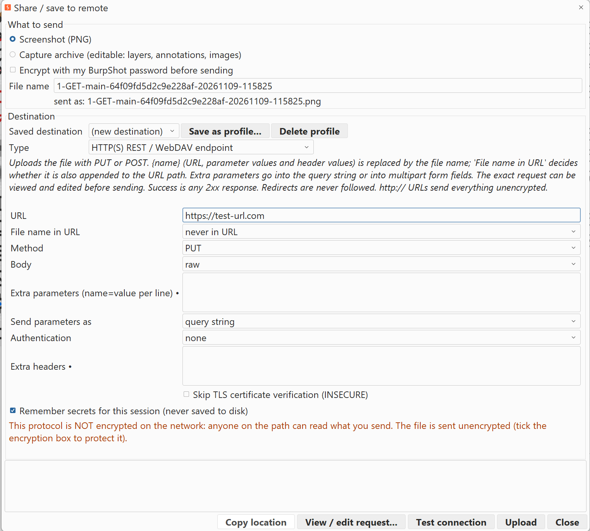

### 13.1 Destinations and logins

| Type | Login options | Notes |
|---|---|---|
| **HTTP(S) REST / WebDAV** | none, **username + password** (Basic), **access token** (Bearer), **API key** (in a header or in the query string), **cookie**; plus extra headers and **extra parameters** | PUT or POST, raw body or `multipart/form-data`. You decide whether the file name goes into the URL (*File name in URL*). Any 2xx is success. Works for WebDAV (Nextcloud, ownCloud), for fixed upload endpoints such as `/api/upload`, and for custom evidence APIs. The exact request can be viewed and edited. |
| **Amazon S3 / S3-compatible** (MinIO, Wasabi, R2...) | none (public), **pre-signed URL**, **access key + secret** (+ session token) | AWS Signature V4. Custom endpoints use path-style addressing. |
| **Google Cloud Storage** | none (public), **access token** (`gcloud auth print-access-token`), **HMAC key** (S3 interoperability), **signed URL** | You do not have to give real cloud credentials: a short-lived token or a signed URL is enough. |
| **Dropbox** | **access token** | Folder path; add or overwrite. Up to 150 MB. |
| **Google Drive** | **access token** | Optional parent folder ID. |
| **Microsoft OneDrive / SharePoint** (Graph) | **access token** | Up to 4 MB per file. |
| **Azure Blob Storage** | **SAS token** | Container URL + SAS. |
| **FTP / FTPS** | anonymous, **username + password** | Plain FTP, explicit FTPS (AUTH TLS) or implicit FTPS (990). Creates the remote folders. |
| **SFTP / SCP** (SSH) | **password**, **private key** (pasted or a file, optional passphrase) | See host keys below. |
| **Network share** (SMB / NFS / UNC) | handled by your operating system | A folder path such as `\\server\share\evidence` (Windows uses your session's credentials), or a mounted path (`/mnt/share`, `/Volumes/share`, `Z:\`). BurpShot does not log in to SMB / NFS itself: connect the share first (mapped drive, mount, or just be signed in). |
| **Local folder** | - | A folder on this machine. |

**Network settings.** For the HTTP(S)-based destinations (REST / WebDAV, S3, Google Cloud Storage, Dropbox, Google Drive, OneDrive, Azure) the box **Send through Burp's network settings** is ticked by default: the upload then goes through Burp's own HTTP engine, so Burp's upstream proxy, TLS and connection settings apply (needed on networks that only allow Internet access through a proxy). Because Burp lists requests sent by extensions in its **Logger**, such a request - including its credentials - is visible there and can be saved in the Burp project; untick the box to send it directly from BurpShot instead (your proxy settings are then not used). Redirects are never followed and certificates are verified in both modes unless you tick *Skip TLS certificate verification*. FTP/FTPS, SFTP/SCP and network-share / local-folder destinations are not HTTP and always connect directly. Uploads run in background threads that are stopped when the extension is unloaded.

### 13.2 Fixed endpoints, extra parameters and the request view

Upload endpoints differ, so the generic **HTTP(S) REST** destination does not guess. Three settings control what is sent:

| Setting | Values | Does |
|---|---|---|
| **File name in URL** | `append to URL path` (default) | `{name}` in the URL is replaced by the file name; without `{name}` the name is appended as `/<name>` (`https://host/files` -> `https://host/files/shot.png`). Good for WebDAV / object stores. |
| | `only where {name} is` | The name is inserted only where you put `{name}`; otherwise the URL is used as typed. |
| | `never in URL` | The URL is used exactly as typed - for a fixed endpoint such as `https://host/api/upload`. |
| **Extra parameters** | one `name=value` per line | Blank lines and lines starting with `#` are ignored; the value is everything after the first `=`. `{name}` in a value becomes the file name. At most 30. Treated as secret (never saved in a profile), because parameters often carry keys. |
| **Send parameters as** | `query string` / `multipart form fields` | *Query string*: appended to the URL (properly encoded, after any query already there). *Multipart form fields*: extra text parts sent **before** the file (needs *Body = multipart/form-data*). |

`{name}` also works inside the values of the **extra headers** lines (for example `X-File-Name: {name}`). In multipart uploads the file part's `filename` is always the file name.

**View / edit request...** shows the request that will be sent - without the file's bytes, which are one marker line - so a large PNG does not make it hard to read:

```
POST https://files.example.com/api/upload HTTP/1.1
Host: files.example.com
Content-Type: multipart/form-data; boundary=----BurpShot7b73609a1b07e2fd
Content-Length: 123940
Authorization: Bearer {{secret:token}}

------BurpShot7b73609a1b07e2fd
Content-Disposition: form-data; name="project"

42
------BurpShot7b73609a1b07e2fd
Content-Disposition: form-data; name="file"; filename="shot.png"
Content-Type: image/png

[[BurpShot: the file contents are inserted here]]
------BurpShot7b73609a1b07e2fd--
```

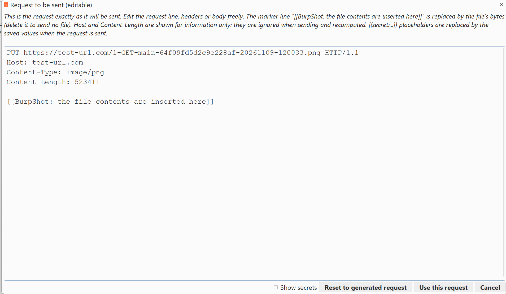

* **Secrets are masked** as `{{secret:...}}` tokens, so the dialog can be screenshotted or shared on screen; tick **Show secrets** to check the real values. Tokens are filled in when the request is sent.
* The marker line `[[BurpShot: the file contents are inserted here]]` is replaced by the file. Delete it to send no file (the result then says *file not included*); it may appear only once.
* **Edit freely**: method (PUT, POST or PATCH), URL, headers, body. **Use this request** makes the upload send your version; an *edited request will be sent* note appears under the form and **Discard edit** drops it. *Reset to generated request* starts over from the form.
* `Host`, `Content-Length` and other connection headers are shown for information only: they are managed by the HTTP client and ignored when sending (the result tells you if any were ignored). For multipart bodies the line endings are converted to the CRLF that multipart needs.
* If you change the form after editing, BurpShot asks whether to keep the edited request or go back to the form. If the edited URL points at a **different host** than the destination you configured and the request contains your credentials, you are asked to confirm before they are sent there.
* The edited request goes through the same safety rules as every upload ([13.4](#134-safety-rules-built-into-every-upload)); the parser rejects other schemes than `http` / `https`, credentials in the URL, line-break / control characters in headers, more than 60 headers, and unusual methods.
* The other HTTP-based destinations (S3, Google Cloud Storage, Dropbox, Drive, OneDrive, Azure) show their request **read-only** (signatures and tokens masked), because editing would invalidate the signature - change the destination fields instead. FTP, SFTP and folders have no HTTP request, so the button is disabled.

### 13.3 Saved destinations, secrets, host keys

* **Save as profile...** keeps a destination (type, server, folder, user name...) in Burp's user preferences. **No secret is ever saved**: passwords, tokens, API keys, cookies, private keys, pre-signed URLs and extra headers are not written to disk. With *Remember secrets for this session* ticked they stay in memory until Burp closes, the extension unloads, or you *Lock now*; otherwise you type them each time.
* **SSH host keys** are checked **before** any password or key is sent. The first time a server is used you see its fingerprint and decide whether to trust it; the trusted fingerprint is remembered per `host:port`. If it later **changes**, the connection is refused unless you explicitly confirm a strong warning.
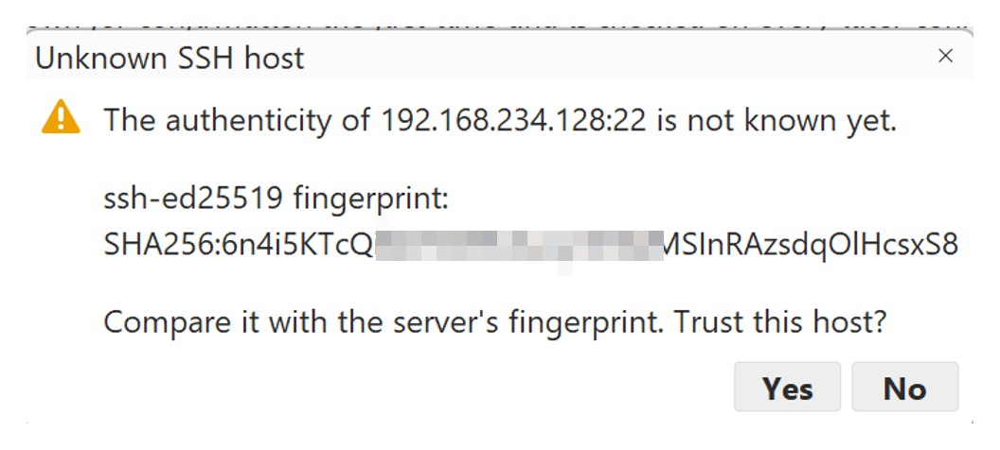

* Only modern SSH algorithms are enabled (Ed25519, ECDSA, `rsa-sha2-*`, AES-GCM / CTR, SHA-2 MACs). A server that offers only CBC, 3DES or SHA-1 `ssh-rsa` is refused with a clear message.

### 13.4 Safety rules built into every upload

* **TLS verification is on.** *Skip TLS certificate verification (INSECURE)* exists for internal servers with self-signed certificates; it applies to that one connection only and the dialog warns you. Plain FTP and `http://` URLs ask for confirmation, because anything on the network path can read them.
* **Redirects are never followed**, so credentials cannot be forwarded to another host. A redirect is reported as an error.
* Only `http` and `https` URLs are accepted; URLs with embedded credentials are rejected.
* **Secrets are removed from every message** shown or logged. File names and remote paths are sanitised (no `..`, separators or control characters); header values and FTP commands are checked for line-break injection.
* Timeouts: 15 s to connect, 120 s per request. Files up to 256 MB.
* The upload runs in the background; the interface stays usable. Nothing is sent until you press **Upload**, and **Test connection** never sends your screenshot.

Limits: uploads overwrite a file of the same name on share / FTP / SFTP; there are no resumable or chunked uploads (hence the size limits for Dropbox and OneDrive); SCP needs the target folder to exist and cannot be probed by *Test connection*; real Dropbox, Drive, Graph, GCS and Azure services and S3 virtual-hosted addressing were not available for testing here (their request formats are covered by mock servers, S3 signing by AWS's published test vectors).

---

## 14. Global settings

Top bar or preview toolbar -> **Global settings...** (non-modal; changes apply immediately).

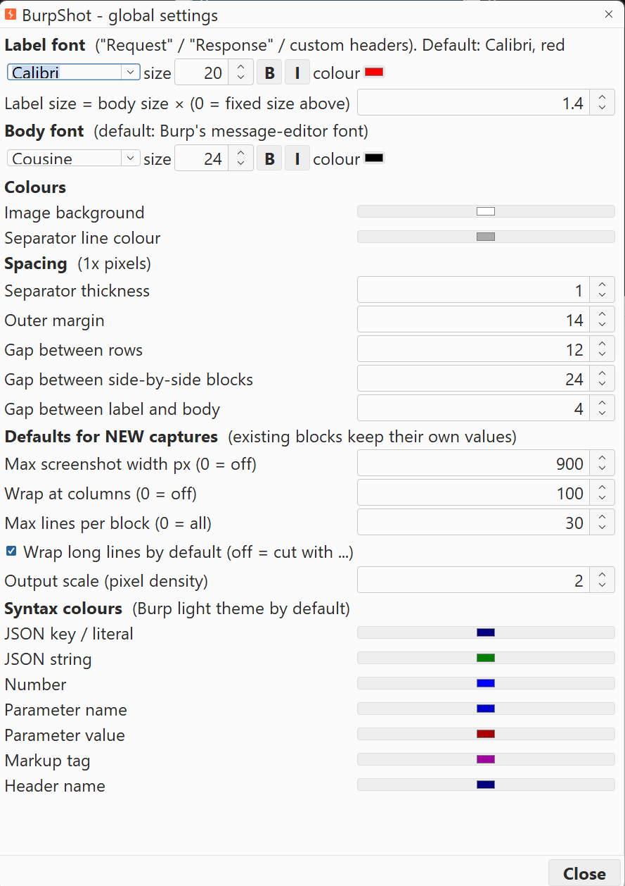

| Section | Settings |
|---|---|
| **Label font** | Font of the "Request" / "Response" / custom headings (default Calibri, red); **Label size = body size x** (default 1.4; 0 = fixed size) |
| **Body font** | Default text font (defaults to Burp's message-editor font) |
| **Colours** | Image background, separator line colour |
| **Spacing** (1x px) | Separator thickness, outer margin, gap between rows, gap between side-by-side blocks, gap between label and body |
| **Defaults for NEW captures** | Max screenshot width, wrap at columns, max lines per block, wrap long lines, output scale (existing blocks keep their own values) |
| **Syntax colours** | JSON key / string / number, parameter name / value, markup tag, header name (Burp light theme by default) |

---

## 15. Keyboard and mouse reference

| Input | Where | Does |
|---|---|---|
| Ctrl/Cmd+F | Capture | Focus the Find bar of the Content tab |
| Enter / Shift+Enter | Find bar | Next / previous match |
| Ctrl+Alt+B | Burp (message editors, Proxy history, Intruder results, Organizer, site map) | Send the selected request(s) to BurpShot; rebindable in Burp's hotkey settings |
| Ctrl/Cmd+Z | Capture | Undo |
| Ctrl/Cmd+Y, Ctrl/Cmd+Shift+Z | Capture | Redo |
| Arrow keys (Shift = 10 px) | Preview | Nudge the selected element or layer |
| Del / Backspace | Preview | Delete the selected element or layer; with a rectangle selection, erase the area from the image layer instead |
| Right-click | Preview | Context menu: delete / manage the element or layer under the cursor, add elements at the click |
| Enter | Preview | Crop the selected image layer to the rectangle selection |
| Esc | Preview | Clear the rectangle selection / deselect |
| Shift (while dragging an arrow end) | Preview | Snap the angle to 15 degree steps |
| Right-click | Content editor / table | Elements and edit actions |
| Double-click a tab | Capture tabs | Rename |
| Middle-click a tab | Capture tabs | Close |
| Ctrl/Cmd+click | Pick from Burp | Click through to Burp (switch tabs, open menus) |
| Mouse wheel | Pick from Burp | Parent / child element |
| Esc | Pick from Burp | Cancel |

---

## 16. Notes and limits

* **Pixelate / blur** only change the exported pixels; the original data never leaves the tab. Use a large cell size for secrets - light
  blur or tiny cells can sometimes be reversed.
* **Fonts:** Calibri is used if installed (on Linux, Carlito is substituted). Any installed font family can be typed in. Tables use Segoe UI
  and terminals a monospaced font (Cascadia Mono / Consolas / Menlo / DejaVu Sans Mono), falling back to the system default if missing.
* **Labels:** by default "Request" / "Response" are 1.4x the body size so they keep their proportion at any Burp font size.
* **Image layers** cannot carry text-anchored annotations; use free elements, or point an arrow at them from text above.
* **Free elements** belong to the layer that was selected when they were added, but sit at fixed canvas positions.
* **Drawing** is raster: it is stored at the output scale used when the layer was created and scaled if you change the scale later.
* **Bucket fill** can swallow thin text if tolerance is high; the fill reads the whole picture, including the drawing layer.
* **Pick from Burp** reads Swing components, so it works on Burp's tables, labels, buttons and text fields; elements drawn in custom ways
  may only be available as an image snapshot. Tables are limited to 200 rows.
* **Terminal colours** come only from ANSI escape codes in the pasted text; BurpShot cannot read colours out of another window.
* **Scale, width and recoloured schemes** are saved per capture.
* **Copy image** and the **Preview window** produce plain images by design. Encryption applies to saved captures, and - when you tick the box - to **Save PNG** and **Share** (see the table in [12.3](#123-encryption-at-rest)).
* Saved captures from a project can only be opened by BurpShot with the same (or a newer) version; an archive made by a newer version is refused with a message.
